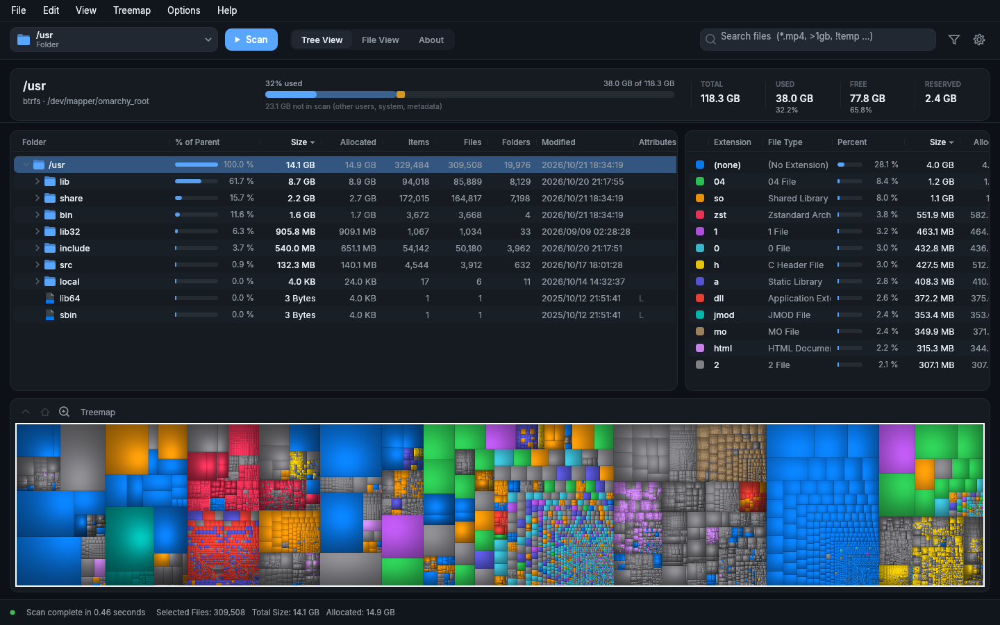
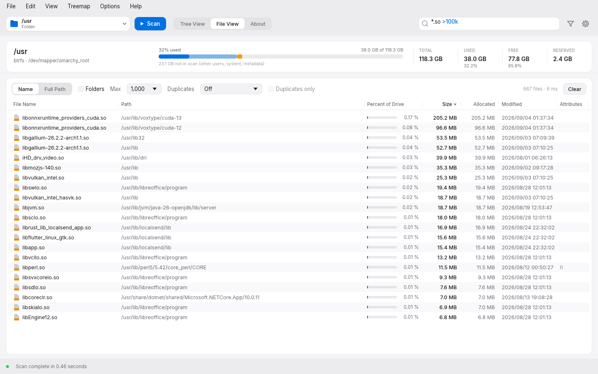

# DiskMosaic

A fast disk space analyser for Linux, macOS and Windows, written in Rust.
It's modelled on [WizTree](https://diskanalyzer.com): one quick scan, then a
tree view, a cushion treemap and a searchable file list that all respond
instantly.



The disk is scanned once, in parallel, into a compact in-memory index. The
tree view, treemap, file list, search, filters and duplicate finder all work
from that index and never touch the disk again.

## Why it's fast on NTFS

On NTFS drives (Windows, and Linux `ntfs3`/`ntfs-3g` mounts) DiskMosaic
reads the Master File Table directly, the same technique WizTree uses,
instead of walking folders. That's one mostly sequential read, and it skips
the free parts of the MFT using `$MFT:$BITMAP`.

| 700k-entry NTFS USB hard disk, cold cache | time |
|---|---|
| Folder walk | 262 s |
| MFT read | 17 s (disk-bound) |
| Rescan, warm cache | 0.3–1 s |

On Linux, reading the raw device needs root. DiskMosaic asks for your
password once per session and streams only the MFT through a small helper
(`diskmosaic --mft-dump DEV`). It can also install a udev rule that gives
the logged-in user access to NTFS partitions (`uaccess`), after which no
prompt is needed. When you scan a folder on a spinning NTFS disk, DiskMosaic
walks it for up to 2 seconds and switches to the MFT if it turns out to be
big.

The headless CSV export was checked row for row against WizTree 4.33's own
MFT scan of the same drive (700,604 rows). Sizes, allocated sizes (including
alternate data streams), modification dates and attribute values all match.

## Features

- **Tree view**: % of parent, size, allocated size, item/file/folder counts,
  dates and attributes, "[N Files in …]" grouping, and a file type panel
- **Treemap**: cushion shading (WizTree's model), zoom, hover, labels, free
  space, and PNG export
- **File view**: search every file using WizTree's syntax (wildcards, `|` for
  OR, `!` for NOT, `>1gb`, dates, `=folder`, `namelen>`, `\regex\`,
  `dupcount>`), plus duplicate detection
- **Filters and export**: scan-result filters, CSV/TSV export and import
  (WizTree-compatible), and file type export
- **Live updates**: file system monitoring keeps the results current; delete,
  move to trash, rename, copy, open, reveal in file manager and open a
  terminal from the app
- **Themes**: nine themes plus Auto, 11 accent colours, ten treemap colour
  schemes and a custom palette
- **Translations**: drop WizTree's `locale/<lang>/LC_MESSAGES/default.po`
  folders next to the executable



## Install

You'll need a recent stable Rust toolchain (edition 2024, so Rust 1.85 or
later).

```sh
git clone https://github.com/divyanshchandhok/diskmosaic
cd diskmosaic
cargo build --release
./target/release/diskmosaic [PATH...]
```

Or install it into `~/.cargo/bin`:

```sh
cargo install --git https://github.com/divyanshchandhok/diskmosaic
```

`mimalloc` is a default feature. Build with `--no-default-features` to use
the system allocator instead.

Settings are stored in your platform's config directory. For a portable
setup, create an empty `diskmosaic.json` next to the executable and it will
be used instead.

## Command line

WizTree-style options work for headless export. For example:

```sh
diskmosaic / /export=disk.csv /exportfolders=0 /filter="*.mp4|*.mkv"
diskmosaic /home /treemapimagefile=home.png /treemapimagewidth=3840 /treemapimageheight=2160
```

Run `diskmosaic --help` for the full list. `--name=value` works too.

## Development

```sh
cargo test --release
# Offscreen screenshots of every screen into target/snapshots:
WT_SNAP_PATH=/usr cargo test --release snapshots -- --ignored
# Timing of search / treemap / filter / duplicates:
WT_SNAP_PATH=$HOME cargo test --release bench_views -- --ignored --nocapture
```

## License

[MIT](LICENSE). The bundled Inter font is under the SIL Open Font License;
see [`assets/fonts/Inter-LICENSE.txt`](assets/fonts/Inter-LICENSE.txt).

DiskMosaic is an independent project and isn't affiliated with or endorsed
by WizTree or Antibody Software. "WizTree" is used only to describe
compatibility.

Created in [T3 Code](https://t3.codes).
